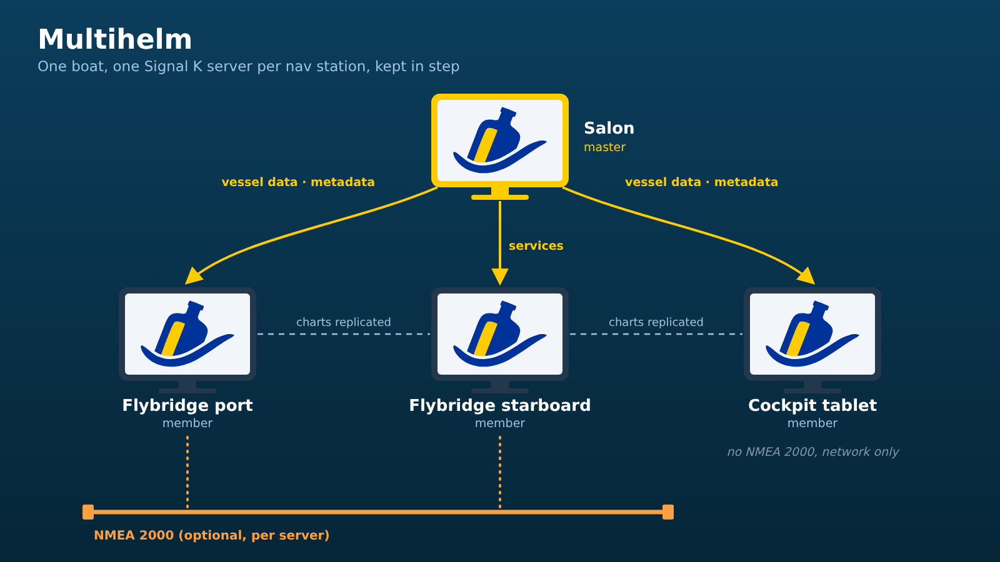

# Multihelm

Keeps several Signal K servers on one boat in step, one per nav station,
without depending on a single one. Every server holds a full copy of what is
replicated and works on its own; when one is off, the others carry on, and it
catches up when it comes back.



Multihelm owns the membership (finding and pairing the boat's servers) and the
transport. Other plugins register what they want replicated as a _dataset_.
The first one is
[signalk-charts-provider-simple](https://github.com/dirkwa/signalk-charts-provider-simple):
chart files and shared ENC cells.

## Pairing

Install Multihelm on every server and set **This server is the boat's
master** on one of them ([The master](#the-master)). Then, on each of the
others, open **Server → Plugin Config → Multihelm** and:

1. **Pair** with the master: pick it from the servers found on the network,
   or enter its address.
2. **Approve on the master**: log in there and approve the request
   “Multihelm on _this server_” under **Security → Access Requests**. The
   settings link to it and show the pairing as soon as it is approved.
3. **Allow on this server**: once paired, the settings ask for admin access
   to this server, to write the master's vessel data, metadata and source
   priorities here. Click **Allow**.

A server without security needs no approval. Every plugin that uses
Multihelm shares the pairing.

A server takes over what the servers it is paired with share. Pairing a
server with the master is enough for the master's settings, history and
services; for datasets that go both ways, such as charts, pair the other
server with it too.

Needs Signal K server 2.31 or later: peers read the replication routes with a
readonly device token.

Multihelm is enabled when it is installed.

## The master

Set **This server is the boat's master** in the plugin settings of one
server. Plugins that work on one server only (a weather router, rules,
alarms to NMEA 2000) run on the master, and the other servers use them
through it; replicated datasets do not need a master. Every server asks its
paired peers every 30 seconds whether they are set to be the master, apart
from the transfers, and a master that has not answered for two and a half
minutes no longer counts.
When several servers are set, the one with the smallest server id is the
master, and the plugin status says to set one only.

## Vessel data, metadata and source priorities from the master

The vessel is described once, on the master. The other servers take over its
vessel data from **Server -> Settings** (name, MMSI, call sign, length, beam,
draft, air height, ship type) and the metadata set for paths (display names,
units, zones, alarm limits) and the source priorities from **Data -> Source
Priorities**, and follow every change once a minute. A change made on another
server is replaced by the master's. GPS antenna positions stay with each
server, and so does the metadata of a path the master has none for, such as
a device that only one server reads; metadata the master removes goes on the
other servers too. Each of the three can be turned off per server in the
plugin settings.

Source priorities name a source by its connection, such as `can0.115`, so
they match on another server only where the source comes in under the same
connection name: give the NMEA 2000 bus the same connection name on every
server. Once the master has priorities set, a server's own are replaced by
them as a whole, so groups and overrides set only there are gone, and a
source only that server has is in none of the master's groups. While none
are set on the master, each server keeps its own.

To write them so they survive a restart, Multihelm asks its own server once
for admin access: click **Allow** in its settings on each server that is not
the master, or approve it under **Security -> Access Requests** there. A
server without security needs nothing. A new MMSI takes effect on that server
at its next restart, as when it is changed by hand.

## Using the master's services

A plugin can let the other servers serve what the master provides, without a
copy of their own: charts, for example. Each server then answers at
`/plugins/signalk-multihelm/master/<path>` with the master's answer, so a
browser at a station only ever talks to its own server, with its own login.

Only GET requests are forwarded, only to the paired master, and only under
the paths a plugin registered; admin and login routes never are. The master
is asked with the readonly pairing token, never with the caller's
credentials, and the route follows this server's own security: whoever may
not read here cannot read through it either. While no other server is the
master, it answers 503.

## History from the master

While the master has a History API provider (signalk-questdb, for example),
every other server answers its own History API from the master's, so history
graphs on any station show the master's history and it is kept once on the
boat. A server with a history provider of its own keeps it; the server's
settings say which provider is the default. This stops when the master is
gone or has no history, and can be turned off per server in the plugin
settings. The master records what it receives itself. It needs Signal K
2.32.0 or later on the server that is not the master.

## How replication works

- Each entry of a dataset carries a counter and the server that last changed
  it. A change takes the counter one past the current one; two servers
  changing the same entry unseen tie, and the higher server id wins. Every
  server reaches the same result without a master and without clocks.
- Deletions are kept as tombstones for 30 days, so a server that was off
  follows them when it comes back.
- Files are checked by size and SHA-256, fetched with resume, and offered
  only once they have not changed for 30 seconds.
- Every server asks each paired peer for changes once a minute, and sooner
  when a plugin reports a change.

## For plugin authors

Multihelm publishes its API as the PropertyValue `multihelm`:
`{ apiVersion: 1, registerDataset, peers, serverId, role, master, onRoleChanged, registerMasterRoute, masterPath, fetchMaster }`
from its start, and
`{ apiVersion: 1 }` after its stop. Follow the last value, register your
datasets whenever the methods appear, and unregister in your own `stop()`.
The types are in [`src/api.ts`](src/api.ts). A plugin that runs on the master
only starts its work when `role()` is `'master'` and follows `onRoleChanged`.
A plugin that serves the master's data on the other servers registers the
path prefix it needs with `registerMasterRoute('/signalk/v1/api/resources/charts/')`,
hands browsers `masterPath(path)` and reads the master itself with
`fetchMaster(path)`.

```ts
app.onPropertyValues('multihelm', (values) => {
  const mh = values.at(-1)?.value
  handle?.unregister()
  handle = mh?.registerDataset?.({
    id: 'my-plugin/things',
    list: async () => [...],     // what this server holds now
    apply: async (entry) => {},  // take over a peer's entry (verified files)
    remove: async (key) => true  // a peer deleted it; false keeps it here
  })
})
```

## License

Apache-2.0
