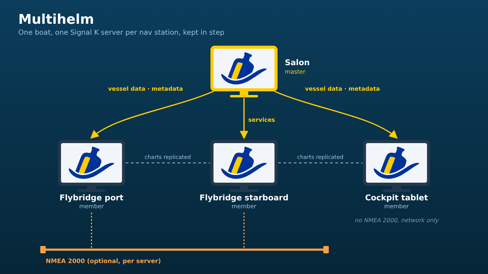

# Multihelm

Keeps several Signal K servers on one boat in step, one per nav station,
without depending on a single one. Every server holds a full copy of what is
replicated and works on its own; when one is off, the others carry on, and it
catches up when it comes back.



Multihelm owns the membership (finding and pairing the boat's servers) and the
transport. Other plugins register what they want replicated as a _dataset_.
The first one is
[signalk-charts-provider-simple](https://github.com/dirkwa/signalk-charts-provider-simple):
chart files and shared ENC cells.

## Pairing

Install Multihelm on every server and set **This server is the boat's
master** on one of them ([The master](#the-master)). Then, on each of the
others, open **Server → Plugin Config → Multihelm** and:

1. **Pair** with the master: pick it from the servers found on the network,
   or enter its address.
2. **Approve on the master**: log in there and approve the request
   “Multihelm on _this server_” under **Security → Access Requests**. The
   settings link to it and show the pairing as soon as it is approved.
3. **Allow on this server**: once paired, the settings ask for admin access
   to this server, to write the master's vessel data, metadata and source
   priorities here. Click **Allow**.

A server without security needs no approval. Every plugin that uses
Multihelm shares the pairing.

A server takes over what the servers it is paired with share. Pairing a
server with the master is enough for the master's settings, history and
services; for datasets that go both ways, such as charts, pair the other
server with it too.

The settings show each paired server online or offline, with its Signal K
and Multihelm versions and why it cannot be reached. Every server also lists
the servers paired with it, so the master shows the others; a server on an
older Multihelm version is not listed there until it is updated.

Servers with SSL on are paired the same way, by their HTTPS address or their
HTTP one, which then leads to HTTPS. When no CA that Node knows has signed a
server's certificate, as when Signal K made it or
[signalk-ssl](https://github.com/dirkwa/signalk-ssl) issued it, Multihelm
trusts the certificate the server presents when it is paired: the CA's, with
signalk-ssl, so the server's renewed certificates are trusted as well. Should
the certificate change for good, or a server paired over HTTP turn SSL on,
its settings ask to pair it again.

Needs Signal K server 2.31 or later: peers read the replication routes with a
readonly device token.

Multihelm is enabled when it is installed.

## Routes and waypoints

Routes, waypoints, regions and notes are the same on every server of the
boat: one made or changed at one station appears at the others within a
minute or so, and one deleted there is deleted at the others. There is no
master for them; when two stations change the same route before they hear
of each other, the change of the server with the higher server id wins.
Multihelm reads and writes them through each server's Resources API, so
they are kept by whichever resources provider the server uses, and charts
and tracks are left to their own plugins. A deletion counts once the server
announces it, as it does for every deletion through the Resources API while
Multihelm runs; a resource missing from a listing, as when its provider
fails, is not taken for deleted. When a failure leaves it unclear, a
deleted route can come back, but none is lost. Turn **Keep routes and waypoints in step** off on a server to keep
its own.

## The master

Set **This server is the boat's master** in the plugin settings of one
server. Plugins that work on one server only (a weather router, rules,
alarms to NMEA 2000) run on the master, and the other servers use them
through it; replicated datasets do not need a master. Every server asks its
paired peers every 30 seconds whether they are set to be the master, apart
from the transfers, and a master that has not answered for two and a half
minutes no longer counts.
When several servers are set, the one with the smallest server id is the
master, and the plugin status says to set one only.

### When the master is gone

Other servers can take over while the master is gone: give each one a place
under **Take over as master when the master is gone** (first, second, ...).
When no server set to be the master has answered for three and a half
minutes, counted from a server's own start too, the reachable server with
the lowest place becomes the master,
with everything that follows the master: the plugins that run on the master
only, the autopilot, the course, the alarms, the history and the charts it
shows. When the master set by hand is back, it takes the role back.

A server becomes the master only once the one before has stopped acting as
it, so two never run the master's plugins at once; a server acts until its
plugins that run on the master only have stopped, and keeps trying a stop
that failed. A server taking over also needs the votes of most servers:
each server votes for the one it would make the master, so two that share
the reachable servers never both take over. No server takes over while a
paired server runs a Multihelm too old to say whether it acts. As soon as any server may
take over, a server is the master only while it reaches most of the boat's
paired servers, itself included; on a boat of two, the one set by hand
counts as most. A server cut off from the others, the master included,
stops the plugins that run on the master only, while the others carry on.
A boat with only one of three servers switched on therefore has no master;
leave **Never** on every server to keep the master set by hand alone. Pair
every server with every other one, so they all count the same servers.
A server that is set to be the master, or no longer is, says so when it
next asks its peers, which it does right after the setting changes, so the
role moves within seconds.

## Plugins that run on the master only

Some plugins must run on one server only: an autopilot provider, for
example, so that only one server sends commands to the autopilot. Tick them
under **Plugins that run on the master only** in Multihelm's settings. The
list is the same on every server: it is kept in step like the routes, so it
can be changed on any of them, and a server that becomes the master already
knows it.

Each server starts those plugins while it is the master and stops them
while another server is, through its own plugin settings, as the admin UI
does: it shows them as disabled on the other servers, and they stay so
across a restart. Their own settings are left as they are, so set them up
on every server that may become the master. While no master is found,
nothing is switched, unless this server reaches too few of the boat's
servers (see _When the master is gone_): then it stops them. While another server is the master, a plugin on the
list turned on by hand here is turned off again within a minute. Switching uses the same admin access as
taking the vessel settings over (see below), on the master too.

## Vessel data, metadata and source priorities from the master

The vessel is described once, on the master. The other servers take over its
vessel data from **Server -> Settings** (name, MMSI, call sign, length, beam,
draft, air height, ship type) and the metadata set for paths (display names,
units, zones, alarm limits) and the source priorities from **Data -> Source
Priorities**, and follow every change once a minute. A change made on another
server is replaced by the master's. GPS antenna positions stay with each
server, and so does the metadata of a path the master has none for, such as
a device that only one server reads; metadata the master removes goes on the
other servers too. Each of the three can be turned off per server in the
plugin settings.

Source priorities name a source by its connection, such as `can0.115`, so
they match on another server only where the source comes in under the same
connection name: give the NMEA 2000 bus the same connection name on every
server. Once the master has priorities set, a server's own are replaced by
them as a whole, so groups and overrides set only there are gone, and a
source only that server has is in none of the master's groups. While none
are set on the master, each server keeps its own.

To write them so they survive a restart, Multihelm asks its own server once
for admin access: click **Allow** in its settings on each server that is not
the master, or approve it under **Security -> Access Requests** there. A
server without security needs nothing. A new MMSI takes effect on that server
at its next restart, as when it is changed by hand.

## Using the master's services

A plugin can let the other servers serve what the master provides, without a
copy of their own: charts, for example. Each server then answers at
`/plugins/signalk-multihelm/master/<path>` with the master's answer, so a
browser at a station only ever talks to its own server, with its own login.

Only GET requests are forwarded, only to the paired master, and only under
the paths a plugin registered; admin and login routes never are. The master
is asked with the readonly pairing token, never with the caller's
credentials, and the route follows this server's own security: whoever may
not read here cannot read through it either. While no other server is the
master, it answers 503.

## The autopilot from every station

Only one server may send commands to the autopilot, but it should be
operated from the chartplotter at any station. On the servers that are not
the master, Multihelm serves the master's autopilot in their own Autopilot
API: it registers as their autopilot provider for the master's autopilot
devices and sends every command (engage, standby, mode, course changes,
tack, gybe, dodge) on to the master's Autopilot API. It reads the master's
autopilot state every second and publishes it on its own server, so a
chartplotter there shows it as on the master. Autopilot alarms are not
passed on yet.

Run the autopilot provider plugin on the master only (see _Plugins that run
on the master only_), so the other servers do not drive the autopilot
themselves. Commands need write access on the master: when a server first
finds an autopilot there, Multihelm asks the master for it, and the request
waits under **Security -> Access Requests** on the master until it is
approved. Its settings on the other servers show which request to approve.
On the master itself Multihelm steps aside, so its own provider serves.
Turn it off per server with **Operate the master's autopilot from this
server**.

## The course from every station

The active destination or route is the same on every server: set it at any
station, and all the others take it over. A server that is not the master
reads its own course and the master's each second. When only its own
changed, it sends it to the master, and the other servers take it over from
there; otherwise it takes the master's over. Two stations changing the course
within the same second is the one case where the master's course holds.

What is kept in step is the course as set: the destination, or the route,
its direction and the point it is on, the arrival circle and the target
arrival time. So when the master and another station both move on to the
next point at an arrival, they end on the same point, not one further. Each
server works out bearings and cross-track error from its own position, and
a leg that starts at the vessel's position starts where that server was when
it took the course over.

Sending the course to the master uses the same write access on the master as
the autopilot (see above), and taking it over the same admin access on this
server as the vessel settings. Turn it off per server with **Keep the course
the same as on the master**.

## Alarms from every station

Every active alarm on the master sounds on every station, and silencing or
acknowledging it at any station does it at all of them. A server that is not
the master reads the master's alarms each second and raises each one through
its own Notifications API, marked as the master's, so its chartplotters show
and sound it like any other. Silencing or acknowledging one here is sent to
the master, and whatever the master has silenced or acknowledged is done
here too. When the master clears an alarm, or another server becomes the
master, the alarm goes from this server as well.

Stations on the same NMEA 2000 bus see the same alarm themselves. A server
that already has an alarm of its own on a path does not show the master's
on top of it: it keeps its own and only keeps it in step, so silencing it
here silences it on the master and the other way round. Alarms are matched
by path, as each server gives its alarms ids of its own. An alarm the master
does not have stays this server's own.

This uses the same write access on the master as the autopilot (see above).
It needs the server's Notifications API with notification management on,
and does nothing otherwise. Turn it off per server with **Show the master's alarms here**.

## History from the master

While the master has a History API provider (signalk-questdb, for example),
every other server answers its own History API from the master's, so history
graphs on any station show the master's history and it is kept once on the
boat. A server with a history provider of its own keeps it; the server's
settings say which provider is the default. This stops when the master is
gone or has no history, and can be turned off per server in the plugin
settings. The master records what it receives itself. It needs Signal K
2.32.0 or later on the server that is not the master.

## How replication works

- Each entry of a dataset carries a counter and the server that last changed
  it. A change takes the counter one past the current one; two servers
  changing the same entry unseen tie, and the higher server id wins. Every
  server reaches the same result without a master and without clocks.
- Deletions are kept as tombstones for 30 days, so a server that was off
  follows them when it comes back.
- Files are checked by size and SHA-256, fetched with resume, and offered
  only once they have not changed for 30 seconds.
- Every server asks each paired peer for changes once a minute, and sooner
  when a plugin reports a change.

## For plugin authors

Multihelm publishes its API as the PropertyValue `multihelm`:
`{ apiVersion: 1, registerDataset, peers, serverId, role, master, onRoleChanged, registerMasterRoute, masterPath, fetchMaster }`
from its start, and
`{ apiVersion: 1 }` after its stop. Follow the last value, register your
datasets whenever the methods appear, and unregister in your own `stop()`.
The types are in [`src/api.ts`](src/api.ts). A plugin that runs on the master
only starts its work when `role()` is `'master'` and follows `onRoleChanged`.
A plugin that serves the master's data on the other servers registers the
path prefix it needs with `registerMasterRoute('/signalk/v1/api/resources/charts/')`,
hands browsers `masterPath(path)` and reads the master itself with
`fetchMaster(path)`.

```ts
app.onPropertyValues('multihelm', (values) => {
  const mh = values.at(-1)?.value
  handle?.unregister()
  handle = mh?.registerDataset?.({
    id: 'my-plugin/things',
    list: async () => [...],     // what this server holds now
    apply: async (entry) => {},  // take over a peer's entry (verified files)
    remove: async (key) => true  // a peer deleted it; false keeps it here
  })
})
```

## License

Apache-2.0
